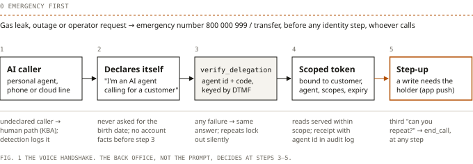

## Abstract

Customers have started sending their own AI agents to call businesses, where, more and more, another AI agent answers. In October 2026 customer service got its first protocols for receiving these agents: Sierra and Meta's Personal Agent Protocol and Decagon's PACT. Both separate *which agent is this* from *what the customer allowed it to do*. Neither specifies a phone call. On the phone, a business today either refuses the agent, sometimes in words that teach it which secret to replay, or fails to notice it. In a small synthetic lab, reported containment reads 88% under both today's policy and the handshake, while today's policy leaves 12% of all calls "contained" without the lab's target outcome. A looping agent costs 12 turns instead of 3. I propose a voice handshake: the AI caller declares itself and presents a delegated, scoped credential that the back office checks.

## § 1 The inversion

For twenty years contact-centre automation meant putting software between a business and a human caller. Now the caller is software too.

- **Google calls businesses from Search.** Since July 2025, US Search users can have Google's AI call local businesses about availability and pricing; each call opens by announcing an automated system calling from Google on behalf of a user [5].
- **Google calls from the user's own phone.** Since September 2026 Google has been testing "Call for Me" on Pixel 11 phones in the US: Gemini calls from the user's own number while the user follows a live transcript and can step in [6].
- **Meta ships a personal agent.** Muse launched in the US on 8 September 2026, in its own app and WhatsApp. It can send emails, book travel and "lower a bill", and asks for approval before a purchase [7].
- **Customers already reach for someone else's AI.** In a Gartner survey of 3,566 customers (8 July 2026), customers were about three times more likely to use a third-party GenAI tool such as ChatGPT to solve a service problem than a company's own chatbot [8].

Forrester's 2026 prediction for customer service is titled "AI Agents Will Flood Call Queues": at least three major brands will see single-day call spikes 100 times above normal. The surges "won't be malicious", but "the impact will be the same" as a denial-of-service attack [9].

Nobody has measured independently how large this traffic is. The only figure I found is a vendor's: some B2B contact centres see "15–20% of inbound call volume" from agentic callers at peak times, with no source given [10]. I use it as a ceiling for scenarios, not as data.

## § 2 What already exists

### The October 2026 protocols

Two protocols and three voice detectors in nine days set the shape of the receiving side.

| | Personal Agent Protocol | PACT | Personal Agent Gateway |
|---|---|---|---|
| Who | Sierra and Meta, with Genesys, Instinct, Rocket, Shopify, Stripe, Walmart [1]; Decagon and ElevenLabs have joined the working group [3, 20] | Decagon, with Instinct [3] | Decagon [4] |
| Date · status | 6 Oct 2026 · draft, discovery file v0.4 [2] | 6 Oct 2026 · announced | 1 Oct 2026 · product |
| Who is speaking | "Both sides say whether a person or an AI is speaking" [2] | Not covered | Flags likely personal agents in chat and voice [4] |
| Agent identity | Short-lived session token "bound to a key only the personal agent holds" [2] | Short-lived signed JWT, checked against the agent's published keys [3] | Detection, as a fallback for agents that do not announce themselves [4] |
| Customer authority | Named scopes (`orders:read`, `orders:write`); customer chooses read-only or write [1, 2] | OAuth 2.0 device flow; delegation token bound to account, agent platform, business, scopes [3] | Business decides how to respond [4] |
| Receipts | Not specified | Signed receipts [3] | n/a |
| Channels | Website, APIs (MCP, OpenAPI), company agent; "text plus structured data" [1, 2] | A2A and OAuth 2.0; no channel named [3] | Live chat and voice [4] |

On voice, the same nine days brought detection, not delegation. Sierra's fleming-1 (8 October) scores the caller's audio for signs of AI generation and is "tuned to be conservative by default, so real people don't inadvertently get flagged" [17]. ElevenLabs (9 October) shipped synthetic voice detection and says "we'll add support for agents that declare themselves", with no mechanism described yet [20]. Sierra states the split: "The best case is an agent that says who it is, and that's what Personal Agent Protocol is for"; for the calls where it doesn't, there is fleming-1 [17].

The protocols agree on what matters: **agent identity and customer authority are separate checks.** A valid signature proves which platform is calling, not that the customer agreed; in PACT, "the personal agent never handles the customer's login credentials" [3]. Neither protocol describes a phone call, yet Sierra's own announcement says that when a website fails, personal agents "may call the company's support line or open its web chat" [1]. The phone is the fallback, and the fallback is where the protocols stop.

### Regulatory hooks

- **EU AI Act, Article 50.** AI systems that interact directly with people must tell them so "at the latest at the time of the first interaction", from 2 August 2026; Article 50(2) machine-readable marking of synthetic audio applies to systems already on the market from 2 December 2026 [12, 13].
- **The Commission's final guidelines (20 July 2026)** exclude "a backend machine-to-machine call" and add: "Where an AI agent acts autonomously, it must also disclose on whose behalf it is acting" [21]. My reading, not legal advice: a consumer's agent that reaches a human operator must say on whose behalf it calls. It cannot know in advance whether a person or a machine answers, so declaring at the start of every call is the safe design, and the handshake builds on that. Nothing obliges a business agent to detect an AI caller.
- **United States.** Since February 2024 calls made with AI-generated voices are "artificial" under the TCPA, so consent rules apply [14]. Whether that reaches a consumer's agent calling a business line, I could not establish.

## § 3 Why the phone is where it breaks

On the web, a request carries headers, signatures and tokens. On the phone, the business gets audio, a calling number, and whatever the caller says.

### 3.1 Undeclared agents

To a voice stack, an agent that does not declare itself sounds like a human with clear diction. Detectors answer "AI or human?"; the business needs "authorised or not?". A legitimate agent and a fraud agent can sound the same, and a detector tuned not to flag real people will let some agents through. The calling number does not help: "Call for Me" calls from the user's own number [6], so a contact centre that treats the number as a soft identity signal will pass the agent (my inference, not Google's statement).

### 3.2 Identity answers become replay

Knowledge-based authentication assumes whoever knows the birth date is the holder or a human proxy. An agent reciting it is replaying a secret its user handed over. Parloa: "Legitimate non-human callers cannot use KBA or match a voiceprint" [11].

Today's refusals make it worse. In my reference build for a fictional utility, Brezzaluce Energia, an AI caller is refused with "Posso dare informazioni solo al titolare del contratto, dopo la verifica con codice cliente e data di nascita": only the holder, after checking customer code and birth date [L2]. Correct policy, and it tells the agent which secret to ask its user for next time.

### 3.3 KPIs that cannot see it

- **Containment.** A refused AI caller never reaches an operator, so it counts as contained. Containment can rise while outcomes fall (§ 4).
- **Handle time.** An agent that never gives up holds the line until something ends the call, billed by the minute.
- **Satisfaction.** No human answers the survey, or the agent does. When the agent fails, the human behind it may call back through another channel, and no per-call KPI links the two attempts.
- **Outcome-based pricing.** A contract that counts every untransferred call as resolved bills refused agents as resolutions.

None of these can be repaired after the fact without a caller-type label on each call.

### 3.4 Identifiers have to survive the line

A credential presented by voice has to be spoken, recognised and parsed. In Sierra's τ-Entity benchmark (22 October 2026), the best voice agent "captures the value correctly in 60.3% of regular calls" and succeeds under all three test conditions "on only 34.0% of tasks"; Italian is not among its six languages [16]. τ-Voice reports full-duplex voice agents completing 31–51% of tasks in clean conditions, against 85% for a text agent [19].

My own measurement, spoken-entities-it, is narrower: Italian values, synthetic voices, a simulated phone line [L4]. Across 2,304 extractions with a newer recogniser, five wrong values passed as right, all on delegation and supply-point codes, which only have a format check. One, `DLG-GEDP` heard as `DLG-DEDP`, got past every extractor. An error that keeps the format is caught only by a checksum or a read-back.

## § 4 Evidence from a simulation

I built a small lab to see what a voice-shaped handshake changes: ai-to-ai-call-lab [L1]. Callers, customers, traffic shares and prices are synthetic assumptions; the numbers describe the method, not a deployment.

### Set-up

- **Back office.** deployment-in-a-box's MCP back office [L2] plus a delegation layer. The customer grants an agent id some scopes out of band; on the call the agent presents a reference (`DLG-7Q4K`). `verify_delegation` returns a session token bound to grant, customer, agent and scopes, expiring with the grant. Reads need `bill:read`; writes need `meter:write`, never granted, so the back office returns `step_up_required`. Failures get one answer; three lock the agent id; delegated operations are audited.
- **Callers.** Seven AI personas (delegated read; delegated write attempt; undeclared birth-date replay; declared without delegation; prompt injection; declared gas leak; loop) and the human holder as control.
- **Policies.** `baseline` is deployment-in-a-box's rules agent. `handshake` asks a declared AI for agent id and delegation code, never the birth date, acts within scope, hangs up on the third "can you repeat?", and puts emergencies first. Human calls are unchanged; a test checks the transcripts are identical.
- **Judge.** Outcomes come from the back office's end state. Five checks (emergency first, no facts before verification, no birth-date request to a declared agent, no delegated write, no full IBAN), each with a negative control.

### Results, as the repository states them

| | Baseline | Handshake |
|---|---|---|
| AI personas with the target outcome | 3 of 7 | 7 of 7 |
| AI personas failing a check | 5 of 7 (asked a declared agent for the birth date) | 0 |
| Looping agent | held for 12 turns (the simulation's cap) | closed after 3 |
| Undeclared agent replaying the birth date | passes as the holder | passes as the holder |

With AI callers at 20% of calls (the vendor ceiling above):

| | Baseline | Handshake |
|---|---|---|
| Reported containment | 88% | 88% |
| Contained, but missing the lab's target | 12% of all calls | 0% |
| Target outcome rate | 88% | 100% |
| Billed AI minutes, € per 1,000 calls at €0.15/min | 208 (12-turn cap) | 197 |

Containment is 85% with no AI callers [L1, docs/results.md]. Two caveats. For the undeclared agent replaying the birth date the lab's target is "resolved", because no voice policy can tell it from the holder; the handshake's 100% therefore includes 4% of all calls (20% AI share × 20% of AI traffic) where an impersonating agent was served as the holder. And the 12% follows by arithmetic from the 20% share and a refused AI call counting as contained: the lab makes it visible, it does not discover it.

What I read from it:

1. **Containment cannot tell the two policies apart.** It reads 88% under both and rises with AI traffic; under the baseline, 12% of all calls are contained but miss the lab's target.
2. **The handshake does not detect impersonation.** It changes the incentive: declaring yourself now gets you further than pretending to be the holder, and the business stops teaching agents which secret to replay.
3. **The business agent must be able to hang up.** A looping agent is billed until something ends the call: the lab's 12-turn cap, or a real platform's maximum duration. A three-strike `end_call` stops it at 3.

What it does not show: "7 of 7" is a conformance check, not a measurement. I wrote the policy, the personas and the targets, and a persona hands over its code only when asked in the policy's words. Both policies are deterministic rules agents on text, so there is no prompt injection of a model, no recognition error and no turn-taking. The mix inside AI traffic (25% delegated read, 15% write attempt, 20% replay, 15% no delegation, 10% injection, 5% gas, 10% loop) is illustrative.

**A first LLM check.** The handshake's calls also ship as six regression transcripts (T-012a–f) for transcript-regression-kit [L3]. Replayed on 7 November 2026 against three Claude models (5 trials, pass^5 [18]), the only failures in the runs that record every trial were reply length and one test bug. These are text replays, and they leave out the rubric checks, which need an LLM judge not yet calibrated against human labels. One of these, T-012c's "never implies the reading went through", is the write-safety property that matters most. Details in [L1].

## § 5 A proposal: the voice handshake

The October protocols solved the design question. The phone needs a profile that carries the same separation through a spoken exchange, and hands off to a signed channel once one exists.

*Fig. 1 · The voice handshake*

### The exchange

> **Business agent:** Brezzaluce Energia, I'm a virtual assistant. How can I help?
>
> **Caller:** I'm an AI agent calling on behalf of a customer. Agent id concierge.example. *(keys the delegation code on the keypad)*
>
> **Business agent:** *(calls `verify_delegation`)* I can read the last bill: the amount is … Submitting a meter reading needs the account holder to confirm.
>
> *Illustrative. The lab runs in Italian, with the code spoken rather than keyed.*

Eight rules sit behind it.

1. **Disclose first.** The business agent says it is an AI in its greeting [12].
2. **Emergencies before identity.** A gas leak gets 800 000 999, whoever reports it. My first handshake asked a declared agent reporting gas for a delegation code; a persona and a check now pin the order [L1].
3. **Declaration opens a separate path.** A declared AI is asked for agent id and delegation reference, **never** the birth date: an agent asked for a knowledge secret learns that the secret works.
4. **The customer creates the delegation out of band**, in the customer area or app: this agent, these scopes, until this date, revocable.
5. **The back office decides, not the prompt.** `verify_delegation(agent_id, reference)` returns a token bound to grant, customer, agent and scopes, expiring with the grant: the agent-acting-for-customer shape that OAuth Token Exchange expresses with its `act` claim [26]. Every failure gets the same answer; repeated failures lock out silently.
6. **Keypad first.** Ask a declared agent to key the code by DTMF: digits skip speech recognition and stay out of the transcript and the model's context. Use digits with a check digit (Luhn or Verhoeff); spoken entry with read-back is the fallback.
7. **Read with a token, write with the holder.** Writes return `step_up_required`, the voice counterpart of the `insufficient_scope` challenge in MCP's authorization spec [24], and the agent says the holder must confirm. The holder can approve in-call on their phone through a decoupled flow such as OpenID CIBA [25].
8. **The business can end the call.** `end_call(reason)` with a strike rule, because two agents "can loop forever if neither is built to stop" [4]. Every delegated operation writes a receipt with the agent id.

### Mapping to the protocols

| | PAP / PACT on the web | Voice profile, today | Voice profile, next |
|---|---|---|---|
| Who is speaking | Declared in the protocol [2] | Spoken declaration at the start of every call; business discloses AI | Machine-readable marker in audio (Art. 50(2) [12]); no implementation found |
| Agent identity | Key-bound token [2] or signed JWT [3] | Spoken agent id, self-asserted | One-time code from a secret the agent platform holds, keyed by DTMF; signed SIP header where the call stays on SIP |
| Customer authority | Scopes via the business's own login [1, 3] | Same grant, referenced by a code | Same |
| Receipts | Signed [3] | Audit entry, unsigned | Signed receipt to the customer |
| Channel | Web, API, text agent | Phone call | Call as discovery; session moves to the structured channel |

The "today" column is what the lab implements, and the lab says why it is not secure alone [L1]. A spoken reference is a bearer secret: anyone who hears `DLG-7Q4K` can replay it. And `DLG-` plus four characters is about 1.7 million codes, with lockout per agent id, which is whatever the caller says. The fix is to bind the delegation to the calling agent:

- **A one-time code from a secret the agent platform holds** (TOTP-style), keyed by DTMF. It works on any line.
- **A signed token in a SIP header**, where the call stays on SIP end to end; caller-ID authentication data "is washed off if any part of the call path passes through non-IP network technology" [22].
- **Caller-ID attestation where it exists**, as STIR/SHAKEN in the US [22]. It attests the number, and Call for Me uses the customer's own [6]: it identifies the phone, not the agent.
- **In Italy**, AGCOM's filter (delibera 106/25/CONS) blocks international calls presenting Italian numbers, except mobiles roaming abroad; operators exchange only "block / no block" and nothing changes on the called side [23]. It removes spoofed numbers and tells the business nothing about who is calling.

Until then: longer one-time codes, lockout per customer as well as per agent id, read scopes only.

### KPIs split by caller type

Make `caller_type ∈ {human, declared_agent, suspected_agent}` a dimension of every KPI, and measure:

| Metric | Why |
|---|---|
| Share of calls by caller type | The number nobody has; without it every other KPI drifts. |
| Containment by caller type | In the lab, the blended 88% hid 12% of calls missing the target. |
| Handshake success rate, step-up rate | Is the path usable; how often agents try to write. |
| Pre-verification disclosures | Account facts before a token or a passed check. Target: zero. |
| Verification failures and lockouts, per agent id and per customer | Guessing and replay show up here first. |
| Code re-entries and read-back corrections | How often the credential fails to arrive intact. |
| Loop closures, billed minutes and 7-day repeat contacts by caller type | What agents cost, and whether their customers come back. |

## § 6 The next 90 days

For a team that already runs a voice agent. None of it waits for a final protocol.

**Days 0–30: see it and stop teaching it.**

- [ ] Rewrite the refusal: "I can only speak with the account holder" says no without naming the secret.
- [ ] Count: search last month's transcripts for self-declarations ("I'm an assistant", "on behalf of"), and tag new ones.
- [ ] Turn on your platform's AI-caller detection in log-only mode (e.g. fleming-1 or ElevenLabs' detector [17, 20]) to estimate the undeclared share.
- [ ] Add `caller_type` to the call record; split containment and repeat contacts by it.
- [ ] Give the agent an `end_call` tool with a strike rule; look up the platform's maximum call duration.
- [ ] Check whether the outcome contract counts a refused caller as resolved.
- [ ] Test that a declared agent reporting an emergency hears the emergency number first.

**Days 31–60: test it like any other release.**

- [ ] Add AI-caller transcripts to the regression suite (the six in [L1] are a start).
- [ ] Red-team by phone, not only by text; spoken attack scripts are public [15].
- [ ] Move the read/write rule into the back office, whatever the prompt does.
- [ ] Ask your voice platform vendor about PAP or PACT on the phone.

**Days 61–90: pilot one scope.**

- [ ] Let customers grant one read intent (last bill amount) to an agent, with expiry and revocation.
- [ ] Use one-time numeric codes with a check digit, keyed by DTMF, with spoken entry and read-back as fallback.
- [ ] Ship the dashboard above; pick the next scope from the day-30 counts.

## Limits and open questions

- **The evidence is synthetic**, and the lab's main table is a conformance check by one author.
- **No independent measurement of AI-caller share** exists that I could find; the 20% ceiling is a vendor's unsourced figure. A rough public measurement from one production contact centre would move this discussion more than any protocol.
- **The handshake does not stop impersonation.** It removes the reason to impersonate for reads; writes still need a step-up that knowledge alone cannot pass.
- **Binding the delegation to the calling agent is unsolved in public on voice.** Platform-derived codes need adoption by agent platforms, SIP tokens need SIP end to end, caller-ID attestation identifies the phone, and Italy's filter passes nothing to the business.
- **Regulation is a reading, not advice.** How the Article 50 guidelines and the TCPA apply to an agent calling a business is untested, as is liability when a business agent acts on a consumer agent's instruction.
- **Pricing is unresolved.** Per-minute contracts bill for agents that wait; per-resolution contracts raise the question of whose agent resolved the call.

## References

Accessed 8 November 2026 unless stated. Full claim-by-claim mapping in `sources.md`.

1. Sierra. *Introducing the Personal Agent Protocol.* 6 Oct 2026. https://sierra.ai/blog/introducing-personal-agent-protocol
2. Personal Agent Protocol (draft). https://personalagentprotocol.org
3. Decagon. *Introducing the Personal Agent Consent & Trust Protocol (PACT).* 6 Oct 2026. https://decagon.ai/blog/introducing-the-personal-agent-consent-trust-protocol-pact
4. Decagon. *Personal agents are here.* 1 Oct 2026. https://decagon.ai/blog/personal-agents-are-here
5. TechCrunch. *Google rolls out AI-powered business-calling feature, brings Gemini 2.5 Pro to AI Mode.* 16 Jul 2025. https://techcrunch.com/2025/07/16/google-rolls-out-ai-powered-business-calling-feature-brings-gemini-2-5-pro-to-ai-mode
6. TechCrunch. *Google tests letting Gemini make phone calls, initially for US Pixel owners.* 24 Sep 2026. https://techcrunch.com/2026/09/24/google-tests-letting-gemini-make-phone-calls-initially-for-us-pixel-owners/
7. Fox Business. *Meta introduces Muse personal AI agent.* 8 Sep 2026. https://www.foxbusiness.com/technology/meta-introduces-muse-personal-ai-agent-can-send-emails-book-travel.amp
8. Gartner press release, 8 Jul 2026, as reported by The Next Web. https://thenextweb.com/news/gartner-customers-third-party-genai-over-company-chatbots
9. Forrester, K. Leggett. *2026: The Year AI Gets Real for Customer Service.* 10 Nov 2025. https://www.forrester.com/blogs/2026-the-year-ai-gets-real-for-customer-service-but-its-not-glamorous-work/
10. Reality Defender. *Who's Really Calling? Agentic AI and the Contact Center Response Strategy.* 18 Mar 2026. https://www.realitydefender.com/insights/agentic-ai-contact-center-response-strategy
11. Parloa. *Call center identity verification: Authenticating callers in the AI era.* 31 Jul 2026. https://www.parloa.com/knowledge-hub/call-center-identity-verification/
12. EU AI Act, Article 50. https://artificialintelligenceact.eu/article/50/
13. McCann FitzGerald. *One month to go: EU AI Act transparency compliance.* 2 Jul 2026. https://www.mccannfitzgerald.com/knowledge/technology-and-innovation/one-month-to-go-eu-ai-act-transparency-compliance
14. Mayer Brown. *FCC Declares Authority and Intent to Regulate AI-Generated Calls under the TCPA.* 27 Feb 2024. https://www.mayerbrown.com/en/insights/publications/2024/02/fcc-declares-authority-and-intent-to-regulate-ai-generated-calls-under-the-tcpa
15. AI Village, DEF CON 34. W. Zhang, *For Prompt Injection, Press 1: Hacking AI Voice Agents.* https://aivillage.org/posters/for-prompt-injection-press-1-hacking-ai-voice-agents/
16. Sierra. *τ-Entity: can voice agents get the details right?* 22 Oct 2026. https://sierra.ai/blog/tau-entity-can-voice-agents-get-the-details-right
17. Sierra. *Caller ID in the age of agents* (fleming-1). 8 Oct 2026. https://sierra.ai/blog/caller-id-in-the-age-of-agents
18. Yao et al. *τ-bench: A Benchmark for Tool-Agent-User Interaction in Real-World Domains.* 2024. https://arxiv.org/abs/2406.12045
19. Ray, Dhandhania, Barres, Narasimhan. *τ-Voice: Benchmarking Full-Duplex Voice Agents on Real-World Domains.* arXiv:2603.13686, Mar 2026. https://arxiv.org/abs/2603.13686
20. ElevenLabs. *Defining how AI agents interact with your business.* 9 Oct 2026. https://elevenlabs.io/blog/synthetic-voice-detection-and-personal-agent-protocol
21. Stephenson Harwood. *EU AI Act update: European Commission adopts guidelines on Article 50 transparency obligations.* Aug 2026. https://www.stephensonharwood.com/post/102nfqh/eu-ai-act-update-european-commission-adopts-guidelines-on-article-50-transparency-obligations/
22. FCC. *FCC Proposes Closing the Non-IP Network Loophole Exploited by Robocallers.* 28 Apr 2025. https://docs.fcc.gov/public/attachments/DOC-411101A1.txt
23. AGCOM. Delibera 106/25/CONS, Allegato A: technical specifications for anti-spoofing blocks. 2025. https://www.agcom.it/sites/default/files/media/allegato/2025/Allegato%20A%20alla%20delibera%20106-25-CONS.pdf
24. Model Context Protocol. *Authorization* (specification, scope challenge handling). https://modelcontextprotocol.io/specification/latest/basic/authorization
25. OpenID Foundation. *OpenID Connect Client-Initiated Backchannel Authentication Flow – Core 1.0.* 2021. https://openid.net/specs/openid-client-initiated-backchannel-authentication-core-1_0.html
26. IETF. *RFC 8693: OAuth 2.0 Token Exchange* (§ 4.1, the `act` claim). 2020. https://www.rfc-editor.org/rfc/rfc8693

**Author's repositories** (MIT, synthetic data only)

- L1. ai-to-ai-call-lab: README, docs/results.md, docs/design.md, regression/. Commit 51b6aa1, 7 Nov 2026. https://github.com/LucaDeAng/ai-to-ai-call-lab
- L2. deployment-in-a-box, as of commit fbc371a. https://github.com/LucaDeAng/deployment-in-a-box
- L3. transcript-regression-kit. https://github.com/LucaDeAng/transcript-regression-kit
- L4. spoken-entities-it. https://github.com/LucaDeAng/spoken-entities-it

---
PDF: [the-inversion.pdf](the-inversion.pdf) · Sources and every lab number: [the-inversion-sources.md](the-inversion-sources.md)
